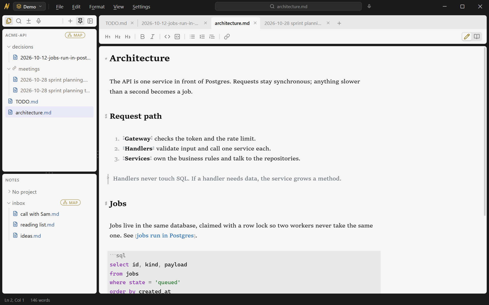
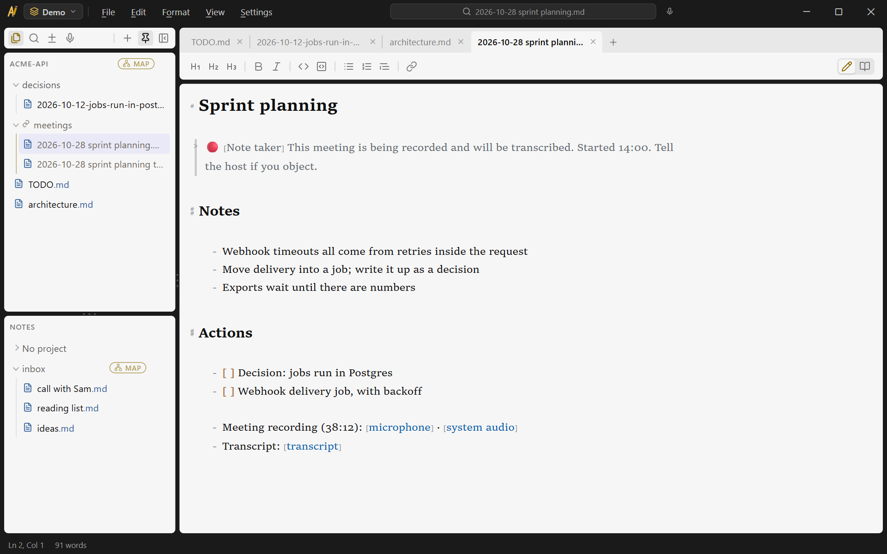

<p align="center">
  
</p>

# asapnotes

Instant-capture markdown notes for Windows. Hit a global keybind, the window is there, type,
get back to what you were doing — built for the "I need to write this down _now_, I'm in a
meeting" moment. An MCP server over the same notes lets an AI go over them with you.

<picture>
  <source media="(prefers-color-scheme: dark)" srcset="docs/screenshots/editor-dark.png">
  
</picture>

## How it stays instant

Nothing cold-starts fast enough to trust in a hurry. asapnotes runs as an always-resident tray
process with a pre-created hidden window; the global hotkey only _shows_ it, which is
near-instant. Two consequences shape every change:

- **Idle footprint is a feature.** The app sits in the tray all day — every dependency pays
  rent in RAM and startup time.
- **Cold start only happens at login** (autostart), so summon latency, not launch time, is the
  number that matters.

## Notes are markdown files

One `.md` file per note in a plain folder you own — greppable, syncable, editable by anything,
and trivially exposed to AI tools over MCP. The app is a fast viewport onto your files, not a
database you must export from. Projects can also live outside the notes folder (see
[below](#projects-outside-the-notes-folder)); cloud share and live collaboration are planned
(see [docs/decisions/](docs/decisions/README.md)).

## Projects outside the notes folder

A project can be any folder on disk. Link a repository and asapnotes edits its `docs/`
folder in place, so design notes, decisions and TODOs stay in the repository and travel with
its history.

Notes that belong to a project but not in its repository go in a **virtual folder**. It
shows inside the project in the explorer, and its files live in a folder of their own that
the repository never sees. "New virtual folder" creates that folder under the app's data
(`%APPDATA%\com.anfifo.asapnotes\virtual`; `virtualFoldersRoot` in `settings.json` moves
it), and "Associate virtual folder" attaches a folder you already have. The default
location is outside `Documents\asapnotes`, so include it in your backups.

Workspaces group projects for display: switching to one shows only its projects.

## Status

Working and in daily use, Windows only. What exists today: tray summon on a global hotkey,
a markdown editor with live preview, tabs, an explorer over projects, linked repositories and
virtual folders, cross-note search, `@`-mention links between notes, a computed project map, a
recent-changes view, an MCP server over the same notes ([mcp/](mcp/README.md)), and meeting
recording with local transcription. What's next lives in [docs/TODO.md](docs/TODO.md); why
things are the way they are lives in [docs/decisions/](docs/decisions/README.md).

**No unrequested network connections.** The app never phones home: no telemetry, no
analytics, no update checks unless you ask for them. You can verify this from the source.

This is a personal project built in the open, with substantial help from AI coding tools.
Issues and pull requests are welcome; responses come when time allows.

## Working with AI tools

Any AI tool can work on the notes as files. The MCP server in [mcp/](mcp/README.md) gives an
assistant the notes workflow through the app's rules:

- find, search, list, outline and read notes in every project it can see, linked
  repositories and virtual folders included;
- create notes, append to them, rewrite a section, and move them; new notes go where
  Settings → Where new notes go says;
- add an item to a project's `TODO.md`, or write a dated entry in its `decisions/`;
- start and stop a meeting recording in the running app, and transcribe it when it stops.

Access is per project and set in the app: off, read or write. A project that is off does
not exist over MCP. `writeScope: "current"` limits writes to the project open in the
app, and meeting control stays off until you turn it on in Settings → MCP. Setup is in
[mcp/SETUP.md](mcp/SETUP.md).

An optional Claude Code plugin reminds a session that notes exist when it works in a folder
a project names as its code ([integrations/claude-code/](integrations/claude-code/README.md)):

```text
/plugin install asapnotes --marketplace Anfifo/asapnotes
```

## Meetings

<picture>
  <source media="(prefers-color-scheme: dark)" srcset="docs/screenshots/meeting-dark.png">
  
</picture>

Start a recording from the app or from an assistant over MCP, and keep typing. The
microphone and the system audio go to files next to the note. Transcription runs on your
machine: the engine and a speech model download once, when you ask, and the transcript
becomes a note linked under the recording, with timestamps, and with each side labelled
when both were recorded.

**Meeting recording captures other people.** It records your microphone and your system
audio to files next to the note, locally, and nothing leaves the machine. Whether you may
record a conversation depends on where you are and who has agreed; telling the other
participants is on you. The app's part is a recording indicator that cannot be missed,
and a notice line it writes into the note when a recording starts and offers to copy for
the meeting chat (`meetingNotice` in `settings.json` sets the wording; `{time}` and
`{date}` are filled in). The notice informs people. Where the law requires their consent,
asking for it is still yours to do.

## Network

asapnotes connects to nothing on its own: no telemetry, analytics, crash reports or
accounts. These are every connection it can make, each started by you:

| When                                                           | Where                                  | What                                                                    |
| -------------------------------------------------------------- | -------------------------------------- | ----------------------------------------------------------------------- |
| You download the transcription engine in Settings or a meeting | `github.com/Anfifo/asapnotes/releases` | The engine build for your app version, checked against a SHA-256 digest |
| You download a speech model                                    | `huggingface.co/ggerganov/whisper.cpp` | The model file, checked against a SHA-256 digest                        |
| Install, only when WebView2 is missing (some Windows 10)       | Microsoft                              | The WebView2 runtime the interface runs in; Windows 11 has it           |

Links in notes open in your browser. The MCP server runs on your machine and makes no
network connections. Update checks are not built; when they are, they will be off until you
turn them on.

## Install

Download `asapnotes_<version>_x64-setup.exe` from the
[latest release](https://github.com/Anfifo/asapnotes/releases/latest). It needs 64-bit
Windows 10 or 11 and installs for your user account without admin rights. The installer is
not signed yet (see the [code signing policy](#code-signing-policy)), so Windows shows an
"unrecognized app" warning; choose "More info" and then "Run anyway".

The app starts with Windows so the summon shortcut, Ctrl+Alt+A by default, always works;
Settings → Startup turns that off. To build the installer yourself, see
[Development](#development).

## Code signing policy

Release binaries are built by the [release workflow](.github/workflows/release.yml) from a
version tag in this repository; nothing that ships is built or uploaded from a personal
machine. Each release is a draft until a maintainer has checked it and published it.

Releases are unsigned today. Signing is planned through SignPath Foundation, which offers
free code signing to open-source projects: free code signing provided by SignPath.io,
certificate by SignPath Foundation.

- Committers and reviewers: [Anfifo](https://github.com/Anfifo)
- Approvers: [Anfifo](https://github.com/Anfifo)

Privacy: this program will not transfer any information to other networked systems unless
specifically requested by the user or the person installing or operating it. The
[Network](#network) section lists every connection it can make.

## Development

Prerequisites: Node 20+, Rust (rustup, MSVC toolchain), VS 2022 Build Tools with the C++
workload, WebView2 runtime (ships with Windows 11).

```powershell
npm.cmd install
npm.cmd run tauri dev     # run the app (first Rust build is slow; later ones are fast)
npm.cmd run tauri build   # produce the installer/bundle
```

In VS Code, <kbd>F5</kbd> runs `tauri dev` in a debug terminal; stopping the session stops
the app. Rust breakpoints need extra setup — see [docs/dev-environment.md](docs/dev-environment.md).

Quality gates before finishing any change:

```powershell
npm.cmd run build         # tsc + vite — must be clean
npm.cmd run lint
npm.cmd run format
cargo fmt --manifest-path src-tauri/Cargo.toml
cargo clippy --manifest-path src-tauri/Cargo.toml
```

> In PowerShell use `npm.cmd` — the `npm.ps1` shim is blocked by execution policy.

## Repo map

| Path         | What it is                                                                                                              |
| ------------ | ----------------------------------------------------------------------------------------------------------------------- |
| `src/`       | React/TypeScript UI (Vite)                                                                                              |
| `src-tauri/` | Tauri 2 shell (Rust): window, tray, hotkey, commands                                                                    |
| `docs/`      | Developer handbook: [TODO.md](docs/TODO.md) (live working file) + [decisions/](docs/decisions/README.md) (decision log) |

## License

[MIT](LICENSE). Use it, fork it, ship it; keep the copyright notice.

The open-source software asapnotes includes is listed with its licenses in
[THIRD-PARTY-NOTICES.txt](THIRD-PARTY-NOTICES.txt), which the installer also ships.
`npm.cmd run notices` regenerates it (needs `cargo install cargo-about --locked --features cli`);
the release workflow does this for every release.
